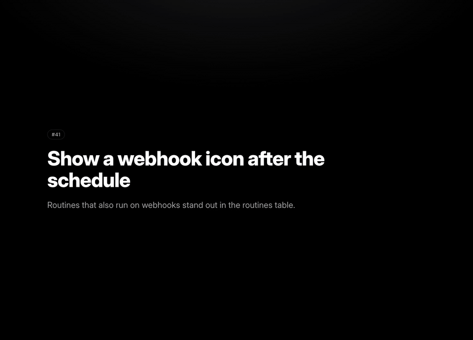

# pr-reel

> A demo reel for every pull request



An agent skill. Ask for a reel on a branch, and your agent records the change against your app and attaches it to the PR: a captioned video for a flow, before/after screenshots for one screen, or a before/after table when nothing visible changed.

## Install

```sh
npx skills add Danilqa/pr-reel
```

Or for Claude Code only: `npx pr-reel`, or as a plugin with `/plugin marketplace add Danilqa/pr-reel` and `/plugin install pr-reel@pr-reel`.

## Usage

On a branch with a change:

> Record a pr-reel for this branch

## Requirements

- Node.js 22 or later, git and ffmpeg
- [gh](https://cli.github.com) to attach the result
- An app that starts locally with one command

## License

MIT
