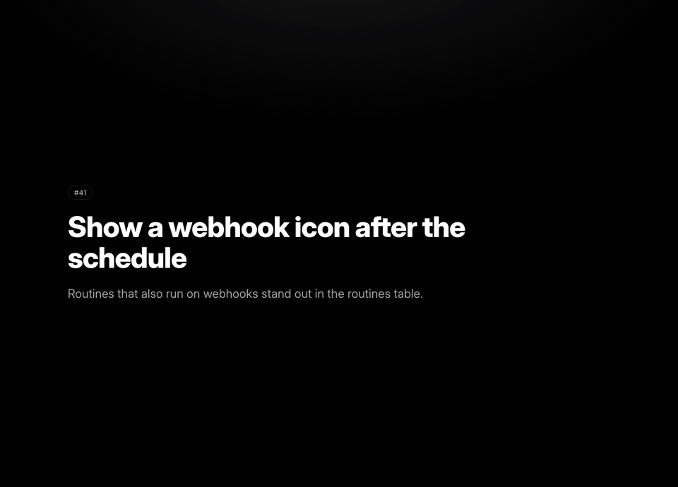

# pr-reel

> A demo video for every pull request, recorded by your agent



<sub>Example: the video pr-reel recorded for <a href="https://github.com/Danilqa/kombinat/pull/41">Kombinat #41</a>. It clicks through the changed flow with captions, then ends on before/after screenshots</sub>

An agent skill. Ask for a reel on a branch, and your agent starts your app, clicks through the changed flow in a browser and **records it as a video**, with captions and a visible cursor. The video goes on the PR, where GitHub plays it inline, with before/after screenshots next to it.

Not every change is a flow: a change to one screen gets just the before/after screenshots, and a change with nothing visible gets a before/after table.

## Install

```sh
npx skills add Danilqa/pr-reel
```

Or for Claude Code only: `npx pr-reel`, or as a plugin with `/plugin marketplace add Danilqa/pr-reel` and `/plugin install pr-reel@pr-reel`.

## Usage

On a branch with a change:

> Record a pr-reel for this branch

## Requirements

- Node.js 22 or later, git and ffmpeg
- [gh](https://cli.github.com) to attach the result
- An app that starts locally with one command

## License

MIT
